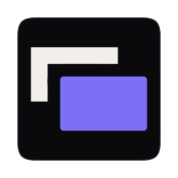
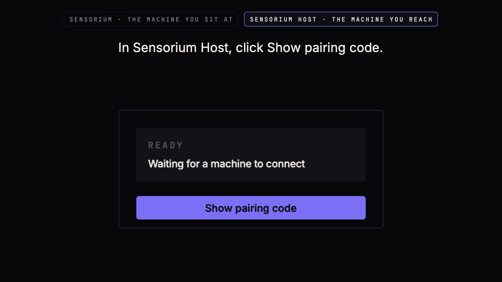
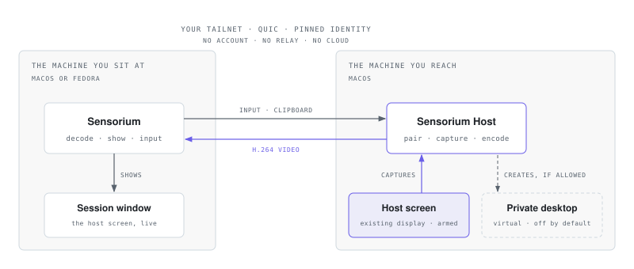
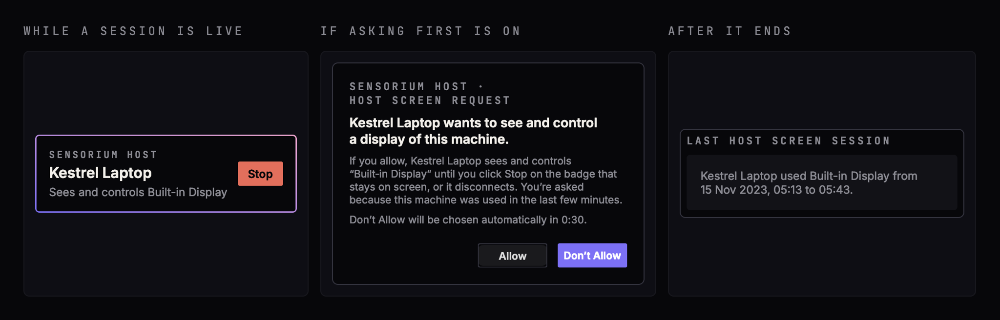

<p align="center">
  
</p>

<h1 align="center">Sensorium</h1>

<p align="center">
  See and control one of your machines from another, over your own Tailscale network.<br>
  Two apps and a six-digit code. No account, no relay, no telemetry.
</p>

<p align="center">
  <a href="docs/install.md">Install</a> ·
  <a href="docs/privacy.md">Privacy</a> ·
  <a href="docs/threat-model.md">Threat model</a> ·
  <a href="CHANGELOG.md">Changelog</a>
</p>

<p align="center">
  <picture>
    <source media="(prefers-reduced-motion: reduce)" srcset="docs/media/pairing-still.png">
    
  </picture>
</p>

<p align="center"><sub>Pairing, staged. Sensorium's windows are drawn offscreen by
<code>Scripts/render-ui-previews.swift</code>, and the editor and terminal by
<code>Scripts/make-readme-media.swift</code>. No screen was recorded.</sub></p>

## What it is

Sensorium is two apps.

- **Sensorium Host** runs on the machine you want to reach. It needs macOS.
- **Sensorium** runs on the machine you sit at, on macOS or Fedora.

The viewer shows the host's screen in a window and sends your keyboard,
pointer and clipboard back. The two talk directly over your tailnet. There is
no server in between, and nothing to sign up for.

It is built for one person with two machines. The host can open at login and
stay reachable with nobody in front of it.

## How it works

1. Open **Sensorium Host** on the machine you want to reach. Grant the
   permissions its window asks for. Click **Show pairing code**.
2. Open **Sensorium** on the other machine. Pick the host from your tailnet,
   or type its address, and enter the six digits.
3. You are in. From then on, click the host in **Your Machines** to connect.

<picture>
  <source media="(prefers-color-scheme: dark)" srcset="docs/architecture-dark.svg">
  
</picture>

## What you can do

- **Work on the host's own screen.** Any display it has, one at a time.
- **Unlock a locked host** by typing at its lock screen, as you would at the
  machine. There is no separate password box.
- **Change the host screen's resolution** from the viewer. The old one comes
  back when the session ends.
- **Share the clipboard** both ways. On by default, one switch to turn off.
- **Send system shortcuts** such as Mission Control, Spotlight and
  Command-Tab to the host, not to the machine in front of you.
- **Reconnect on its own** after a dropped link.
- **Open a private desktop** instead: a separate virtual display that never
  shows on the host's screens. Off by default. The person at the host turns
  it on.
- **Connect by name on the local network**, such as `mini.local`, without
  Tailscale. Off by default, and meant for networks you trust.

## At the host

<p align="center">
  
</p>

The person at the host always knows when someone is on their screen.

- A badge names the connected machine and the display it sees. It stays on
  top, on every Space, with a **Stop** button. Stop is also in the menu bar.
- **Ask me first** can be turned on for any paired machine. Then, if someone
  used the host in the last few minutes, they are asked and must agree.
  It is off by default.
- Every host screen session leaves a local record: which machine, which
  display, and when it started and stopped.
- Screen sharing can be turned off for one paired machine, or the machine
  removed. A live session ends at once.

Sensorium never creates, removes, rearranges or mirrors a physical display.
The one change it makes is the resolution, on request, and it puts that back.

## What pairing proves

Pairing proves that whoever held the viewer at that moment could read the
code on the host's screen. It does not prove who holds that machine later. A
stolen or compromised paired machine can reach the host the way a saved
password can in any other remote desktop tool. Remove it from the host's
paired machines if that happens.

Only machines on your tailnet can reach the host, plus the host's own subnet
while the local network setting is on. The code allows ten wrong guesses
before it is retired. See the [threat model](docs/threat-model.md) for the
rest.

## Requirements

- **Host:** macOS 13 or later, on Apple silicon. Built and tested only on macOS 26.
- **Viewer:** macOS 13 or later, or Fedora 44 with KDE Plasma on Wayland.
- **Network:** both machines on the same Tailscale tailnet. The host needs
  Tailscale even when the local network setting is on.

## Get it

Download each app on its own machine from the
[latest release](../../releases/latest):

- `Sensorium-Host-<version>.dmg` on the machine you want to reach.
- `Sensorium-<version>.dmg` on the machine you sit at.

Open the disk image, drag the app onto the Applications shortcut, and open
it from Applications. The apps are not notarized, so macOS refuses the first
open. Click **Open Anyway** in System Settings, Privacy & Security, once per
app. [Install](docs/install.md) has the steps.

After that, both apps update themselves. Each checks this project's GitHub
releases when it opens and every six hours. It installs a release only if
it carries the project's update signature and the same signing certificate
as the app already running. The host waits until no machine is connected,
and goes back to the old version if the new one does not start.

For Fedora, download the RPM from the [release page](../../releases). It
updates through its package. [Install on Linux](docs/install.md#linux-fedora-44-kde-plasma-on-wayland)
has the steps, including hardware video decoding.

To build from source instead:

```sh
SENSORIUM_ALLOW_ADHOC=1 ./Scripts/package-apps.sh
```

The apps land in `Artifacts/Sensorium/`.
[Build from source](docs/install.md#build-from-source) explains how to keep
macOS permissions across rebuilds.

## Status

It works between the machines it was built on. Pairing, the
pinned-identity QUIC transport, H.264 video, input, clipboard, reconnect, the
host screen and its lock-screen unlock, the private desktop, self-update on
macOS, and the Fedora viewer all run. It is not yet tested on other hardware.

## FAQ

**Why does macOS ask for permissions again after I rebuild?**
An ad-hoc signature changes with every build, so macOS treats each build as a
new app. A self-signed certificate fixes that. See
[Install](docs/install.md#keeping-permissions-across-rebuilds).

**Does it need Screen Sharing turned on?**
Yes, to type at the host's lock screen. Typing there has only been tested with
Screen Sharing on, so the host asks for it until it is on. The host uses Screen
Recording to capture and Accessibility to type and click. Turning Screen
Sharing on makes macOS's own service listen on port 5900. See
[macOS permissions](docs/macos-permissions.md#screen-sharing).

**Does it talk to anything besides my other machine?**
Only GitHub, on macOS, to check for and download updates. Turning automatic
updates off stops that. See [Privacy](docs/privacy.md#update-checks).

**Can I connect from Windows, a phone or a browser?**
No. The viewer runs on macOS and Fedora only.

**What is not in this version?**
Audio, file transfer, multiple users, and unlocking at FileVault's start-up
screen.

## Docs

- [Install](docs/install.md) and [uninstall](docs/uninstall.md)
- [macOS permissions](docs/macos-permissions.md)
- [Privacy](docs/privacy.md): what crosses the wire and what is stored
- [Threat model](docs/threat-model.md)
- [Host screen mode](docs/host-screen-design.md)
- [Wire protocol](docs/protocol.md)
- [User interface spec](docs/ux-spec.md) and [design system](docs/design-system.md)
- [Self-update](docs/self-update-design.md) and [releasing](docs/releasing.md)
- [Testing](docs/testing.md)

## Development

Swift 6. No dependencies. No Xcode. Run the tests with
`./Scripts/run-unit-tests.sh`. [CONTEXT.md](CONTEXT.md) lists the words the
code uses, and [CONTRIBUTING.md](CONTRIBUTING.md) the house rules.

The README media is generated, not captured. To redraw it after a UI change:

```sh
swift Scripts/render-ui-previews.swift Artifacts/ui-previews
swift Scripts/make-readme-media.swift Artifacts/ui-previews
```

## License

GPL-3.0. Copyright (c) 2026 blutarche.
